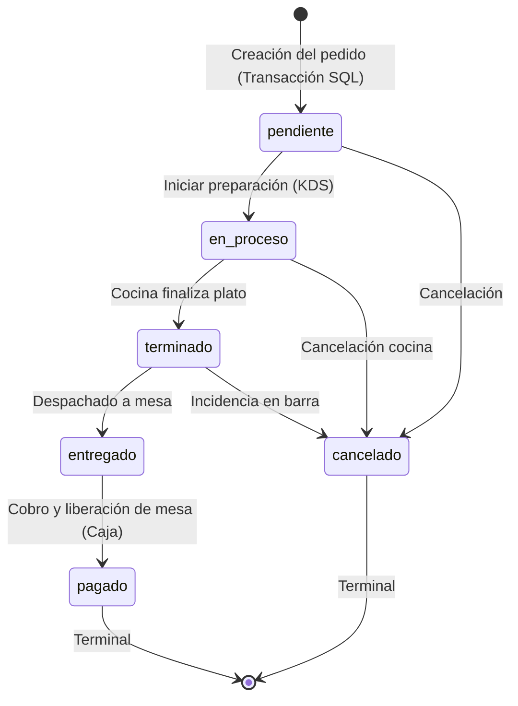

# FOODTECH: Documentación de Arquitectura de Software

**Universidad de la Comunidad (UNICEN) - Cochabamba**  
Carrera: Innovación Digital e Inteligencia Artificial  
Materia: Programación  

---

## 1. Arquitectura en Tres Capas

El backend de FOODTECH implementa una arquitectura desacoplada y estricta en TypeScript:

```
[ Cliente HTTP / Sockets ]
          │
          ▼
┌────────────────────────────────────────┐
│ 1. Capa de Rutas y Middlewares         │
│    - Express Router (/api/v1)          │
│    - Zod Validation                    │
│    - Auth (JWT / Token Mesa)           │
│    - Helmet & CORS                     │
│    - Rate Limiting                     │
└──────────────────┬─────────────────────┘
                   │
                   ▼
┌────────────────────────────────────────┐
│ 2. Capa de Controladores               │
│    - Extracción de parámetros y DTO    │
│    - Formateo de respuesta JSON        │
│    - Manejo de códigos de estado HTTP  │
└──────────────────┬─────────────────────┘
                   │
                   ▼
┌────────────────────────────────────────┐
│ 3. Capa de Servicios (Business Logic)  │
│    - Máquina de estados de pedidos     │
│    - Transacciones ACID de comanda     │
│    - Emisión de eventos Socket.io      │
│    - Lógica de rotación de mesas       │
└──────────────────┬─────────────────────┘
                   │
                   ▼
┌────────────────────────────────────────┐
│ 4. Capa de Repositorios (Persistencia) │
│    - mysql2/promise Connection Pool    │
│    - Consultas SQL parametrizadas (?)  │
│    - Mapeo relacional de entidades     │
└──────────────────┬─────────────────────┘
                   │
                   ▼
          [ MySQL 8.x InnoDB ]
```

---

## 2. Máquina de Estados del Pedido

El ciclo de vida del pedido es gobernado por una máquina de estados determinista. Cualquier transición fuera de las flechas permitidas es rechazada inmediatamente con `HTTP 409 Conflict`.



---

## 3. Arquitectura de Salas y Eventos en Tiempo Real (Socket.io)

```
        ┌───────────────┐
        │ Servidor Node │
        │   Socket.io   │
        └───┬───┬───┬───┘
            │   │   │
  ┌─────────┘   │   └─────────┐
  ▼             ▼             ▼
Sala:         Sala:         Sala:
mesa:{id}     cocina        caja
  │             │             │
  ▼             ▼             ▼
Cliente      Pantallas     Terminal
Móvil QR        KDS        de Caja
```

| Evento | Origen | Destino (Rooms) | Carga Útil (Payload) |
| :--- | :--- | :--- | :--- |
| `pedido:nuevo` | Cliente QR / Garzón | `cocina`, `caja` | Objeto `Pedido` completo con detalles y mesa |
| `pedido:estado` | KDS / Caja | `mesa:{id}`, `cocina`, `caja` | Objeto `Pedido` con nuevo estado |
| `mesa:estado` | Pedido / Caja | `caja` | `{ mesaId: number, estado: EstadoMesa }` |
| `reserva:actualizada` | Caja | `caja` | Objeto `Reserva` |
| `espera:actualizada` | Caja / Recepción | `caja` | Objeto `ListaEspera` |

---

## 4. Diagrama Entidad-Relación de Base de Datos

```
┌──────────────┐       1:N       ┌──────────────┐
│  categorias  ├────────────────►│  productos   │
└──────────────┘                 └──────┬───────┘
                                        │
                                    1:N │
                                        ▼
┌──────────────┐       1:N       ┌──────────────┐
│    mesas     ├────────────────►│   pedidos    │
└──────┬───────┘                 └──────┬───────┘
       │                                │
       │ 1:N                            │ 1:N
       ├──────────────┐                 ▼
       │              ▼          ┌──────────────┐
       │         ┌───────────┐   │detalle_pedido│ (snapshot precio)
       │         │ reservas  │   └──────────────┘
       │         └───────────┘
       │
       │ 1:N
       ▼
┌──────────────┐
│ lista_espera │
└──────────────┘
```
